<picture>
  <source media="(prefers-color-scheme: dark)" srcset="assets/dark.svg">
  
</picture>

### Work

| | | |
|:--|:--|:--|
| **[Ditto](https://github.com/getditto)** | Software Engineer Intern | Multi-collection `UNION` for DQL, the query language of Ditto's offline-first sync platform. Wrote a Rust expression interpreter from scratch (lexer, parser, type checker, evaluator) and shipped it to iOS, Android and Web through UniFFI and WebAssembly, replacing three per-platform implementations. |
| **[TGT Capital](https://github.com/gt-quant)** | Quantitative Developer | SIMD flat and ring L2 order books in Rust: update latency 121 → 103 µs at 50 levels and 1,660 → 870 µs at 200. Async exchange feed listeners and a Rust CatBoost inference pipeline on live book state. |
| **[Tinker Lab](https://github.com/gt-tinker)** | Quantum Compilers Researcher | MLIR/LLVM work on the [Qwerty](https://github.com/gt-tinker/qwerty) compiler (CGO '25): a two's-complement subtraction op ([#57](https://github.com/gt-tinker/qwerty/pull/57)) and modular multiplication circuit synthesis ([#59](https://github.com/gt-tinker/qwerty/pull/59)), both merged upstream. |

### Projects

- **[StageZeroOS](https://github.com/michaelpeters-dev/StageZeroOS)**: an x86 operating system from power-on. A 512-byte assembly boot sector and a second-stage C loader read a FAT12 disk, switch from real to protected mode and launch a freestanding kernel.
- **ByteFight 2026**: 4th of 154 teams in Georgia Tech's AI tournament. Real-time territory-control bot built on beam search, alpha-beta pruning, Zobrist hashing and SIMD evaluation.
- **[L2 order book](https://github.com/michaelpeters-dev/woox_tgt_intro)**: reconstructs an in-memory ETH-USDT perpetuals book from WooX websocket deltas with Tokio and Tungstenite.

### Toolchain

```text
languages   Rust  C/C++  x86 assembly  Python  TypeScript  Swift  Kotlin  Java  SQL
systems     MLIR/LLVM  WebAssembly  UniFFI  SIMD  Tokio  NASM  QEMU  CMake
platform    Git  Docker  AWS  Neovim
```

### Contact

[michaelpeters.tech](https://michaelpeters.tech) · [LinkedIn](https://www.linkedin.com/in/michaelcpeters) · [Email](mailto:michaelcpeters115@gmail.com)
